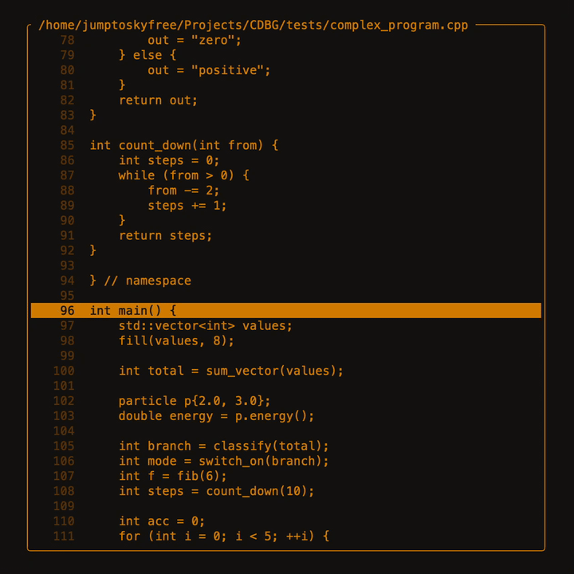

# CDBG



CDBG is a terminal UI debugger for C/C++ programs. It combines a source and
disassembly view with a ptrace-based debugging backend, DWARF symbol lookup, and
an FTXUI interface, so you can step through a program without leaving the
terminal.

> **Platform:** Linux only. The backend uses `ptrace` and `libdw`.

## Features

- Full-screen terminal interface built with [FTXUI](https://github.com/ArthurSonzogni/FTXUI)
- Source-level stepping and instruction-level stepping
- Source and disassembly view, powered by [Capstone](https://www.capstone-engine.org/)
- DWARF debug info and symbol resolution via `libdw`
- Breakpoints with a breakpoint list
- Process, thread, register, and memory inspection
- Stack unwinding and source lookup for the current program counter

## Requirements

- CMake 3.21 or newer
- A C++23-capable compiler (GCC or Clang)
- `pkg-config`
- `libdw` (elfutils)
- Capstone
- FTXUI 5.x
- `fmt`
- `popl.hpp`
- Tree-sitter with the C and C++ grammars
- Catch2 (for the test suite)

On Fedora, the provided script installs the packaged dependencies and builds the
ones that are not available in the repositories:

```sh
chmod +x install_deps.sh
./install_deps.sh
```

On other distributions, install the equivalent packages and make sure
`pkg-config` can find `libdw`, `capstone`, and FTXUI.

## Build

```sh
cmake -S . -B build
cmake --build build -j
```

The resulting binary is `build/cdbg`.

Debug builds enable AddressSanitizer and UndefinedBehaviorSanitizer by default.
To disable them:

```sh
cmake -S . -B build -DCDBG_ENABLE_ASAN=OFF
```

## Usage

Launch CDBG with the path to an executable:

```sh
./build/cdbg --path ./path/to/program
```

CDBG starts the program, breaks at `main`, and opens the debugger view. The title
bar shows the current source file, and the main panel shows source lines or
disassembly depending on the available debug information.

### Keybindings

| Key       | Action                          |
| --------- | ------------------------------- |
| `s`       | Step into (source level)        |
| `n`       | Step over (source level)        |
| `i`       | Step a single instruction       |
| `q`, `Esc`| Quit                            |

## Tests

The test suite uses Catch2 and is enabled by default:

```sh
cmake -S . -B build
cmake --build build -j
ctest --test-dir build --output-on-failure
```

Tests live in `tests/` and use the `simple_program` and `complex_program`
fixtures built alongside the suite.

## Project layout

```text
include/engine/   Debugging backend, symbols, disassembler, process control
include/tui/      FTXUI panels and source view
src/engine/       Backend and engine implementation
src/tui/          Terminal UI implementation
tests/            Catch2 test suite and sample programs
cmake/            Dependency configuration
```

## License

MIT. See [LICENSE](LICENSE).
